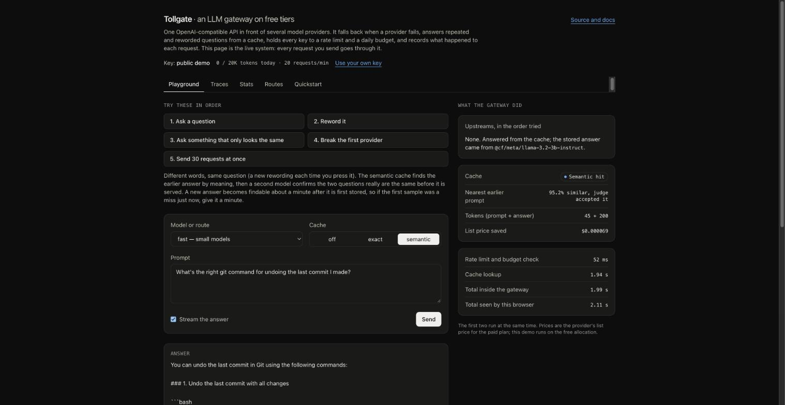
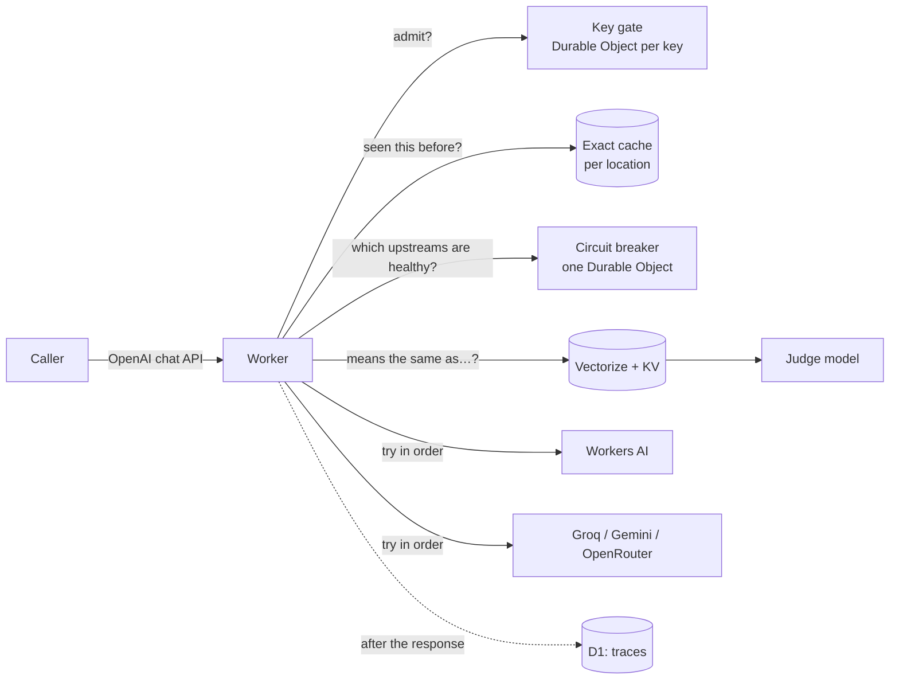

# Tollgate

**An LLM gateway that runs entirely on free tiers.** One OpenAI-compatible API in front of
several model providers. It falls back when a provider fails, answers repeated and reworded
questions from a cache, holds every API key to a rate limit and a daily token budget, and
records what happened to each request.

**Live: [tollgate.iampdt.workers.dev](https://tollgate.iampdt.workers.dev)** is the real
system, not a recording. The playground sends requests through the gateway to real models and
shows what the gateway did with each one.



## What it does

- **One API for several providers.** Callers use the OpenAI chat completions format and a
  route name such as `fast`. The gateway picks the upstream. Cloudflare Workers AI works
  with no key; Groq, Gemini and OpenRouter join the routes when their keys are set.
- **Fallback.** A route is an ordered list of upstreams. One that fails, rate-limits or
  sends no first token in time is skipped for that request and the next one answers.
- **Circuit breaker.** After five failures in a row an upstream is not called at all for
  30 seconds, then tested with a single request.
- **Two caches.** An exact cache for repeated requests, and a semantic cache for reworded
  ones, where a second model confirms the two questions are the same before a stored answer
  is served.
- **Limits per key.** Requests per minute and tokens per day, enforced exactly even when
  requests arrive together.
- **A trace of every request.** Which upstreams were tried, what the cache did, tokens,
  list price, and where the time went. No prompt or answer text is stored in a trace.
- **A dashboard** over all of it: playground, traces, stats, routes.

```bash
curl https://tollgate.iampdt.workers.dev/v1/chat/completions \
  -H "Authorization: Bearer tg_demo_public" \
  -H "Content-Type: application/json" \
  -d '{"model": "fast", "messages": [{"role": "user", "content": "Hello"}]}'
```

`tg_demo_public` is a public key on purpose: 20 requests a minute and 20,000 tokens a day per
visitor, with a cap across all visitors.

## How it works



One request:

```
authenticate → validate → ┬ rate limit and budget ┬→ semantic cache → upstreams in order → answer
                          ├ exact cache           │   (only if asked for,
                          └ circuit breaker state ┘    and the exact cache missed)
```

The three checks in the middle run at the same time. After the answer has gone out, the
gateway counts the tokens against the key's budget, stores the answer, tells the circuit
breaker what happened and writes the trace.

Details: [architecture](docs/architecture.md) · [decisions](docs/decisions.md) ·
[results](docs/results.md) · [API](docs/api.md) · [development](docs/development.md)

## The parts worth a closer look

**A semantic cache that measured its own wrong answers.** The usual design embeds the prompt
and serves the nearest stored answer above a similarity threshold. I wrote 80 labelled pairs,
40 rewordings and 40 questions that look alike but need different answers, and ran them
through the deployed gateway. At a threshold of 0.85 the embedding alone hit 36 of the 40
rewordings and also served 22 of the 40 different questions a wrong answer. "Convert 100
dollars to euros" and "convert 100 euros to dollars" score 0.992. No threshold fixed it, and
neither did four other embedding models. So a match is now confirmed by a second model before
it is served: 31 of 40 rewordings still hit, and 0 of 40 different questions do.

**Where the gateway's own time went.** The first version took 85 to 235 ms before calling a
model, and about 590 ms with the semantic cache on. I added a diagnostic that times each
storage call from inside the Worker. A miss in the key-value store cost about 190 ms; the
per-location cache answered in 3 ms; each Durable Object call cost about 45 ms. Moving the
exact cache and running the three checks at once brought it to about 45 ms for a single
request.

**A limit that is exact.** Each key's limit lives in one Durable Object, which handles
requests one at a time, so two requests can never both take the last slot. In the load test a
key limited to 50 a minute received 200 requests at once: 50 answered, 150 refused.

**Fallback that knows when it is too late.** A non-streaming request can be moved to the next
upstream even if the first one breaks half-way through its answer, because nothing has been
sent yet. A streaming request falls back only until the first token; after that the stream
ends with an error event and no `[DONE]`, so the caller can tell a cut-off answer from a
finished one.

**A mock upstream that misbehaves on request.** `mock/fail-503`, `mock/timeout`,
`mock/midstream` and others are real routes. They are how the tests exercise every failure
path, how the load test runs without spending model quota, and how the public demo shows a
provider going down.

## Measured

All on the deployed gateway on 16 November 2026, called from India. Method and full output:
[docs/results.md](docs/results.md).

| | |
| --- | --- |
| Gateway's own latency, 400 requests at 20 at a time | 59 ms median, 137 ms 95th percentile |
| Exact cache hit, end to end as the client saw it | 82 ms median, 122 ms 95th percentile |
| Rate limit: 200 requests at once on a 50-per-minute key | 50 answered, 150 refused |
| Semantic cache, threshold alone (0.85) | 36 / 40 rewordings hit, 22 / 40 wrong answers |
| Semantic cache, with the judge (0.85) | 31 / 40 rewordings hit, 0 / 40 wrong answers |
| A new answer becomes findable by meaning after | 17 to 62 s over six runs |

The semantic cache saves tokens, not time, when the model behind it is small and fast: a
semantic hit took about 2 s in the demo, which is what the small model takes to answer.

## Run it

You need Node 22 and a free Cloudflare account.

```bash
npm install
cp .dev.vars.example .dev.vars      # set ADMIN_TOKEN
npm run dev                         # http://localhost:5173, with the mock upstream
npm run check                       # types, 88 tests, build
```

Deploying your own, and adding provider keys: [docs/development.md](docs/development.md).

## Tests

88 tests, run inside the Workers runtime with real Durable Objects, D1 and KV.

| | |
| --- | --- |
| Whole requests | Fallback on failure, rate limiting, timeout and a broken stream; 502, 503 and 504; streaming; the demo key |
| Caches | Hits and misses per key, route, history and settings; the judge accepting, refusing, timing out and failing |
| Limits | Exactly the limit under a simultaneous burst; the daily budget; cache hits not charged; revoked keys |
| Policy, without a clock | The token bucket and the circuit breaker as pure functions of state and time |
| Adapters | The OpenAI-compatible and Workers AI adapters against fake upstreams, including events split across network chunks |

## Limits

- **Only Workers AI has answered real requests here.** The Groq, Gemini and OpenRouter
  adapters share one OpenAI-compatible implementation that is tested against a fake
  upstream; I had no keys set for them on this deployment.
- **The semantic cache evaluation is small.** Eighty pairs that I wrote, in English, one
  sentence each. It shows the failure and the fix; it is not a benchmark.
- **The exact cache is per Cloudflare location.** A repeat has to arrive at the same
  location to hit. That bought a 3 ms lookup instead of 190 ms.
- **A new answer is not findable by meaning for up to a minute**, while the vector index
  processes it.
- **A budget can be overshot** by the requests already in flight when it runs out. Tokens
  are counted after an answer, not reserved before.
- **Chat completions with text only.** No tool calling, images, or embeddings endpoint.
- **Free-tier ceilings.** Workers AI gives 10,000 neurons a day. When that is gone the real
  routes return 502 until midnight UTC; the demo's outage route ends in the mock's canned
  reply instead.

## Stack

TypeScript · Cloudflare Workers · Durable Objects · D1 · KV · Vectorize · Workers AI ·
Cache API · React · Tailwind CSS · Vitest

## License

MIT
