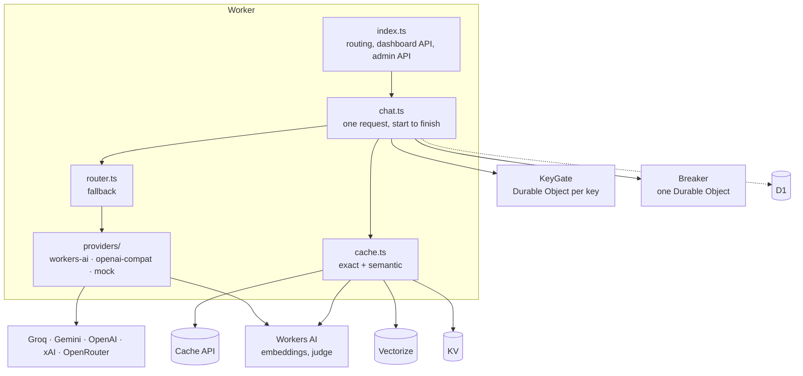

# Architecture

Tollgate is one Cloudflare Worker with a small set of storage bindings. There is no server to
run and nothing that is not on a free tier.



| Piece | Where | What it holds |
| --- | --- | --- |
| Worker | `src/worker` | All request handling. Stateless. |
| `KeyGate` | Durable Object, one per API key (one per visitor for the demo key) | The key's token bucket and today's token count |
| `Breaker` | Durable Object, one for the deployment | Failure counts and open/half-open state per upstream |
| Exact cache | Cache API, per Cloudflare location | Answers keyed by a hash of the request |
| Semantic cache | Vectorize (vectors), KV (answers), D1 (expiry list) | Answers findable by meaning |
| Traces and keys | D1 | One row per request; API keys as hashes |
| Dashboard | Static assets, `src/app` | React app that reads the same API |

## One request

`src/worker/chat.ts` is the whole path, top to bottom.

1. **Authenticate.** The bearer key is hashed and looked up in D1. Looked-up keys are
   remembered in the isolate for 30 seconds.
2. **Validate.** The body is parsed against the chat completions shape. Unknown fields are
   dropped. The `model` is resolved to a route (an ordered list of upstreams) or to one
   catalogued model.
3. **Three checks at once:**
   - the key's `KeyGate` admits or refuses the request;
   - the exact cache is read;
   - the `Breaker` reports which of the route's upstreams are open.
4. **Refused?** 429 with `Retry-After`, and a trace.
5. **Exact hit?** Answer from the cache.
6. **Semantic cache** (only when the key or the request asked for it): embed the last user
   message, find the nearest stored one in the same scope, and if it is similar enough ask
   the judge. A hit answers from KV.
7. **Upstreams.** `router.open` walks the route. It skips open circuits, calls the next
   upstream, and waits for its first token up to a timeout. On failure it moves on.
8. **Answer.** As JSON, or as an OpenAI-style event stream.
9. **After the response** (`ctx.waitUntil`): settle the tokens with the `KeyGate`, store the
   answer in the caches, report each attempt to the `Breaker`, insert the trace.

Nothing in step 9 can delay or fail the answer.

## Upstreams

Every provider implements one method:

```ts
stream(params: ChatParams, signal: AbortSignal): AsyncGenerator<Part>
```

A `Part` is a piece of text, a finish reason, or token usage. Every upstream is read as a
stream even when the caller did not ask for one. That gives one code path, a first-token time
for every request, and a clean point at which fallback stops being possible.

Failures are a `ProviderError` with a kind: `timeout`, `rate_limited`, `server`, `network`,
`auth`, `bad_request` or `aborted`. The kind decides what happens next:

| Kind | Next upstream? | Counts against the upstream's circuit? |
| --- | --- | --- |
| `timeout`, `rate_limited`, `server`, `network`, `auth` | yes | yes |
| `bad_request` | no: the caller gets 400 | no |
| `aborted` (caller left) | no | no |

A request an upstream calls invalid is not sent elsewhere: it would be invalid there too, and
each try spends quota. (A 404 is not that: it means the upstream no longer has the model, and
the route carries on.)

Every provider except Workers AI goes through one OpenAI-compatible adapter. Two things vary
per provider or model and live in the catalog: the name of the token-limit field, and extra
request fields such as a low reasoning effort for models that think before answering.

Routes on this deployment, ordered by measured latency:

| Route | Upstreams, in order |
| --- | --- |
| `fast` | Groq `gpt-oss-20b` → Workers AI `llama-3.2-3b` → Workers AI `llama-3.1-8b` |
| `smart` | Gemini `gemini-3.5-flash-lite` → Groq `gpt-oss-120b` → Workers AI `llama-3.3-70b` → Workers AI `llama-3.1-8b` |
| `premium` | OpenAI `gpt-4.1-mini` → Gemini → Groq `gpt-oss-120b` → Workers AI `llama-3.3-70b` |
| `demo-outage` | a mock that always fails → Groq `gpt-oss-20b` → Workers AI `llama-3.2-3b` → a canned reply |

## Rate limit and budget

`KeyGate` keeps a token bucket (capacity and refill both equal to the key's requests per
minute) and a count of tokens used on the current UTC day. The policy is a pure function,
`admit(state, limits, now)`, so the tests run it without a clock; the Durable Object is a
thin wrapper that loads state, calls it and saves.

A Durable Object runs one call at a time. That is the whole concurrency story: there is no
lock and no compare-and-set, and a burst cannot oversubscribe the bucket.

The public demo key uses two gates per request, one per visitor (by a hash of the address)
and one shared by all visitors, so one person cannot use up everyone's allowance and
everyone together cannot use up the free model quota. It may also only spend Workers AI and
Groq; upstreams at other providers are left out of its routes.

## Circuit breaker

Per upstream: closed → open after 5 consecutive failures → half-open after 30 s → closed on
a successful test, or open again for twice as long (up to 5 minutes) on a failed one.

Half-open is the part that needs shared state. The first request to ask about a half-open
upstream is handed the test and everyone else keeps seeing it as open until that request
reports back or its 20-second lease runs out. Without that, every request in flight would
test a recovering upstream at once.

## Caches

**Exact.** Key: SHA-256 of the key id, the route, every message, and the sampling settings.
Stored in the Cache API with the answer's TTL as `max-age`.

**Semantic.** Only the last user message is compared by meaning. Everything else (key,
route, earlier turns, settings) is hashed into a *scope*, used as the Vectorize namespace,
so a search can only ever find prompts that were asked in an identical context. A candidate
at or above the threshold (0.85) goes to the judge with both prompts; only "yes" makes a hit.
A semantic hit is also written to the exact cache under the new wording.

Stored answers never cross API keys.

## Traces

One D1 row per request: route asked for, upstream that answered, every attempt with its
outcome and duration, cache result, nearest similarity and the judge's verdict, tokens,
list price, and timings (admission, cache lookup, first token, total). No message text.

The stats endpoint aggregates in SQL, percentiles included. A Worker on the free plan gets
10 ms of CPU per request, which is not enough to sort a few thousand rows in JavaScript.

A daily cron deletes traces older than 7 days and vectors whose answers have expired.
